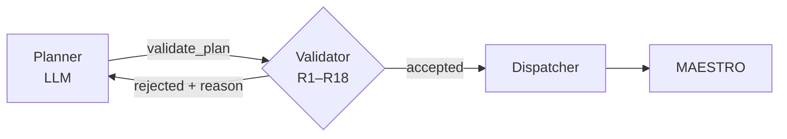
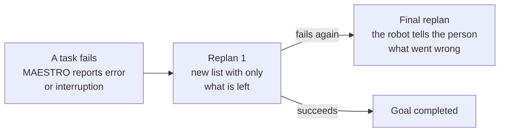

# Planning Module — demonstration explained (base version)

**For:** Alberto Hata · Ericsson
**Module author:** Ervin Bolivar (UNICAMP)
**Presented at:** *SMARTNESS Weekly Hour*, October 23, 2026 — *Semantic IoRT: A Service-Oriented
Research for Intelligent Robotic and IoT Systems* (Ervin Bolivar and César Bastos)

This document explains the **Planning Module** in detail as it operated in the October demonstration:
the problem it solves, how it is built, how it behaved in the scenarios shown, and what
we learned from it. The text is in English; component names, actions, and concepts
retain the English terminology used in the system and the presentation.

---

## Summary

- **What it does.** Turns a natural-language request (“*It's very dark in the room*”) into a list
  of actions that robots and IoT devices in a home can safely execute
  (`do(lamp, turn_on)`).
- **How it does it.** Two **OpenClaw** agents (LLM `gemma4:31b`) — **Supervisor** and **Planner** — wrapped
  in **deterministic code** that builds their context, checks their plans, and tracks execution.
- **The central idea.** *The LLM proposes, the validator decides*: every plan is checked against **18 rules
  (R1–R18)** before reaching the home; if any rule fails, the plan returns to the Planner with the reason and is rewritten.
- **Demo results.** 59% of plans were valid on the first attempt and, with
  Validator feedback, **all dispatched plans met all 18 rules**, at an average cost of ~3.4 s per
  correction and without human intervention. Planning time remained steady at ~11 s.
- **Also included:** live IoT perception (Kafka `maestro.context`), episode-derived memory, dialogue
  with open questions, and **replanning** that does not repeat work already completed.

---

## 1. The problem: from a sentence to safe actions in a changing home

### 1.1 The setting

The demonstration runs in a laboratory **smart home** where people, robots, and devices
share the same middleware, **MAESTRO**:

| People | Robots | IoT devices |
|---|---|---|
| Residents ask for help aloud, in several languages: “*Bring me a glass*”, “*It is too dark here*”. | **mobile**: moves, picks up, delivers, and speaks.<br>**kinova**: a fixed arm that picks up objects. | **Actuators**: lamp, TV, speaker, AC outlet.<br>**Sensors**: temperature, humidity, light, motion. |

### 1.2 The task


*Figure 1. The module's task: a spoken request (“Get the glass from the living room for me”) is
turned into a list of executable actions. Source: SMARTNESS presentation, slide 7.*

The module receives a sentence and returns a list of actions in a domain-specific action language (DSL) with three
verbs:

| Action | Meaning | Example |
|---|---|---|
| `moveto(agent, target)` | the agent moves toward a place, object, or person | `moveto(mobile, glass)` |
| `do(agent, verb, target)` | the agent executes a capability (`pick_up`, `deliver`, `turn_on`, `turn_off`…) | `do(mobile, pick_up, glass)` |
| `say(agent, text)` | the agent speaks to a person | `say(mobile, "Here is your green candy, Eric!")` |

Doing this well requires solving three challenges at once:

1. **Language is loose.** Requests are imprecise, express implicit needs (“it is very
   dark” means “turn on a light”), and include follow-up answers such as “*the red one*”.
2. **The world changes.** People move, devices turn on and off, and sensors
   report new values.
3. **Actions fail.** A robot fails to grasp an object or times out, and the plan has to adapt.

### 1.3 Module boundary

**MAESTRO** is the middleware that exposes the world (agents, objects, states) and executes actions on
robots and devices. It was developed by a colleague and **is not part of the Planning Module**: the module
uses it through its interface (`GET /agents`, `GET /objects`, `POST /addactions`) and its Kafka topics.

**Everything else in this document is the Planning Module**: request intake, the Supervisor,
Context Builder, Planner, Validator, Dispatcher, Execution Tracker, replanning,
IoT perception, memory, and dialogue.

---

## 2. Foundations: two reference architectures

The design draws on two recent works on language agents.

### 2.1 CoALA — *Cognitive Architectures for Language Agents*


*Figure 2. Cognitive architecture of a language agent: (A) a standalone LLM, (B) a language agent
that observes and acts on an environment, (C) a cognitive language agent with modular memory,
reasoning, and a structured action space. Source: adapted from Sumers et al. (2023), Figure 4.*

CoALA proposes organizing a language agent around **memories** (procedural, semantic, episodic),
a **working memory**, and a **decision procedure** that reasons, retrieves, learns, and acts. The Planning
Module adopts this organization: each type of memory has a concrete counterpart in the system
(section 3).

### 2.2 ROSClaw — OpenClaw + ROS 2


*Figure 3. ROSClaw: integrates OpenClaw's cognitive agent with ROS 2 through a model-agnostic
executive layer, with capability discovery, observation normalization, a safety validator, and an audit log.
Source: adapted from Cardenas et al. (2026), Figure 1.*

ROSClaw illustrates the pattern we follow: the LLM agent **does not act directly** on robots. Between
the agent and the world is an **executive layer** that discovers capabilities, normalizes observations,
**validates actions**, and keeps a record. In our module, this role is fulfilled by the Context Builder
(capabilities and observations), the Validator (safety), and episode logging (auditing), with
MAESTRO in place of ROS 2.

---

## 3. Planning Module architecture


*Figure 4. Cognitive architecture and execution workflow of the OpenClaw-based system. (A) Organization
of memory, reasoning, and interaction with the environment. (B) Planning, validation,
execution, and replanning workflow. Source: author's own work.*

**Panel A — the cognitive agent.** Following CoALA:

| CoALA component | In the Planning Module |
|---|---|
| **Procedural Memory** | The LLM (`gemma4:31b`, OpenClaw agents) and the **Agent Code**: prompt rules and the R1–R18 Validator. The rules are accumulated procedural knowledge: each encodes a real error that the system no longer repeats. |
| **Semantic Memory** | The **World State**: agents, capabilities, rooms, objects, and IoT readings. |
| **Episodic Memory** | **Episodes + Graph**: previous runs, preferences, and dialogue. |
| **Working Memory** | What the Planner receives for each request: `intent`, `context slice`, `sensor_readings`, `memory evidence`, and `open question`. |
| **Decision Procedure** | Supervisor → Planner → Validator: *propose · check · retry*. |
| **Actions / Observations** | Action list (DSL) sent to MAESTRO; observations from Kafka. |

**Panel B — the workflow.** A request passes through *Intent* (Supervisor) → *Proposal* (Planner + context) →
*Evaluation* (Validator R1–R18; if rejected, it returns to Proposal) → *Selection* (valid plan queued) →
*Execution* (MAESTRO + tracker) → *Episode* (memory). If execution fails, the workflow returns to
*Proposal* as a **replan**, with a maximum of two rounds.

---

## 4. The pipeline, step by step


*Figure 5. Two OpenClaw agents (in blue) wrapped in code that checks them. Everything else is
deterministic code. Source: SMARTNESS presentation, slide 8.*

Only two steps use an LLM. The rest is **deterministic code**, and this is a design choice: it makes
the system **auditable** (every decision made by the code has an explicit cause), **reproducible** (the same
world produces the same context and the same Validator verdict), and **inexpensive** (the LLM is used only where
it adds value: interpreting language and proposing plans).

| # | Step | Type | Responsibility |
|---|---|---|---|
| 0 | **Request intake** | deterministic | Receives the request through Kafka and resolves identity |
| 1 | **Supervisor** | **LLM** | Interprets intent, language, entities, and answers to open questions |
| 2 | **Context Builder** | deterministic | Builds the world the Planner will see |
| 3 | **Planner** | **LLM** | Writes the plan |
| 4 | **Validator** | deterministic | Checks the plan against R1–R18 and returns the reason for rejection |
| 5 | **Dispatcher** | deterministic | Dispatches one list at a time to MAESTRO |
| 6 | **Execution Tracker** | deterministic | Tracks each task and determines the list's outcome |
| 7 | **Replan** | deterministic + Planner | If something fails, replans only what remains |
| 8 | **Episodes & Memory** | deterministic | Records the run and derives evidence for future requests |

### 0 · Request intake and identity

The request arrives through Kafka. Before planning, the module determines **who is asking** and **who
heard the request**, which are not always the same: a robot can relay a person's voice request.
Identity is resolved against the world state, without an LLM. A person is identified by their ID or
name, and an ambiguous name is treated as unknown. If the data contradict each other (one person's ID
with another person's name), the Planner does not guess: it asks which of the two is speaking.

### 1 · Supervisor (LLM)

The first OpenClaw agent. It reads the request and produces a **structured intent**: intent type
(`comfort`, `delivery`, `other`…), language, mentioned entities, and who is asking. It also sees any pending **open
question** for that person and indicates whether the message answers it. Thus, “*the red one*”
is understood as an answer to “do you want the red candy or the green one?”. The Supervisor **proposes** and the
code **decides**: an answer counts only if it identifies the open question and, for a choice, matches
one of the options offered.

### 2 · Context Builder (deterministic)

Builds the **World State** the Planner will receive, without using any LLM:

- **World:** agents and their capabilities (who can `moveto`, `say`, `pick_up`…), rooms, objects,
  and people, read from MAESTRO.
- **IoT readings:** the latest value of each sensor and the state of each actuator, along with their age (section 7).
- **Memory:** evidence from previous episodes that is relevant to the request (section 8).
- **Dialogue:** the open question, if any.

The context can be **sliced** according to the entities identified by the Supervisor: in the
lamp example, 21 of 80 entities were retained. If there are no matches, the entire world is sent, because
omitting a necessary agent is worse than sending extra tokens. Thanks to this step, the Planner never
has to assume which agents exist or what they can do.

### 3 · Planner (LLM)

The second OpenClaw agent. Given the request, intent, and context, it writes the plan as **phases of
missions**: missions within the same phase are intended to run simultaneously, and phases run in sequence. The
Planner has **a single tool**: `validate_plan`. It cannot dispatch anything on its own; it can only
submit its proposal to the Validator. The code dispatches plans, never the agent.

### 4 · Validator (deterministic)

The heart of the module; explained in detail in section 5. It checks the proposal against the 18
rules. If it rejects it, the Planner receives **each violation with its reason in natural language** (for
example: “*R15 mobile has nothing to deliver: before deliver it must pick_up the object itself*”) and
rewrites the plan within the same session.

### 5 · Dispatcher (deterministic)

MAESTRO executes **one action list at a time**: dispatching a new list replaces the one
in progress. The Dispatcher therefore maintains a **queue**. While a list is executing, new plans
wait. When MAESTRO becomes available, the oldest plan **is revalidated against the current world**
(it was originally validated against the world at planning time) and is then dispatched, or discarded if it
is no longer valid. Each list carries its request identifier, which MAESTRO copies into every task; this
attributes each execution event to the correct request.

### 6 · Execution Tracker (deterministic)

Tracks execution through MAESTRO's Kafka events (task created, task in progress, success, error,
list finished, list cleared). For each list, it determines an outcome: `finished`, `incomplete`,
`abandoned`, `timeout`, or `superseded`. It knows **which missions have already succeeded, which one failed, and which never
ran**. This information feeds replanning and memory.

### 7 · Replan and 8 · Episodes & Memory

These are explained in sections 8 and 9.

---

## 5. Validator: *the LLM proposes, the validator decides*

An LLM is creative, and that creativity is precisely what makes it possible to understand “it is very dark”. But in a
home with robots, a plan with an impossible action, a nonexistent object, or an incorrect sequence is not
acceptable. The Validator resolves this tension: **the LLM proposes freely, and a set of deterministic
rules decides what reaches the home**. No plan reaches MAESTRO without passing all 18 rules.

### 5.1 The 18 rules

| Family | Rule | Rejects a plan when… |
|---|---|---|
| **Plan Structure** | R1 | the structure of phases and missions is invalid |
| | R7 | a `do` action does not specify its verb |
| | R11 | it uses an action that does not exist in the DSL |
| | R12 | it contains no actions: an empty plan is not a solution |
| **Agents and Capabilities** | R2 | it names an agent that does not exist |
| | R3 | it uses an unavailable agent |
| | R4 | it requests `moveto` from an agent that cannot move |
| | R6 | it requests `say` from an agent that cannot speak |
| | R8 | it asks an agent to execute a verb it does not support |
| **Destinations and Objects** | R5 | it sends an agent to a place that does not exist |
| | R9 | it acts on an incorrect target: an unknown object, an unsupported interaction, or a device naming itself as its own target (`do(tv, turn_off)` is correct; `do(tv, turn_off, tv)` is not) |
| **Order and Timing** | R10 | it assigns two actions to the same agent in the same phase |
| | R15 | a robot delivers something without having picked it up first, or without having moved to the person immediately before delivering |
| **Dialogue** | R13 | the attributes of a `say` action are inconsistent (a nonexistent recipient, a choice without options…) |
| | R14 | in the final notification after replans are exhausted, the plan attempts anything other than speaking |
| | R18 | what the robot will say contains an unresolved placeholder, such as `"[temperature]"` |
| **Platform constraints** | R16 | it assigns the grasping of an object to a robot that physically cannot grasp it |
| | R17 | after an object is placed in a container, no robot picks up the container to continue transporting it |

The rules were not designed in the abstract: **many arose from failures observed in the laboratory**. For
example, R9 came from TV tasks that failed because the television named itself as its own
target, and R18 from a robot that literally said “*The temperature is [temperature]*” (translated from Portuguese). This is why we say that
the rules are **accumulated knowledge in procedural memory**: the system learns from its errors and
does not repeat them.

### 5.2 The correction loop



A rejected plan **is not discarded**: it returns to the Planner with the exact reason, and the Planner corrects it. In
the demo:

- **59%** of plans were valid on the first attempt;
- **with retries, all dispatched plans met all 18 rules**;
- each correction added **~3.4 s** on average, **without human intervention**.

---

## 6. Three examples from the demonstration

Each example follows a real demo request from end to end.

### 6.1 IoT — “*It's very dark in the room*”

| 1 · Supervisor | 2 · Context | 3 · Planner | 4 · MAESTRO |
|---|---|---|---|
| Intent: `comfort`<br>Language: English<br>Asked by: Eric | Light sensor: 15 lux<br>Lamp: off<br>21 of 80 entities retained | `do(lamp, turn_on)`<br>Valid on the first attempt | Dispatched at 7.9 s<br>Lamp on at 10.1 s |

No one asked to “turn on the lamp”. The Supervisor recognizes a comfort need; the context supplies
the evidence (15 lux, lamp off), and the Planner connects the need to the single action that
addresses it. Within 10 seconds, the light was on.

### 6.2 Robots — “*I feel like eating something sweet, bring me a green candy*”

| 1 · Supervisor | 2 · Context | 3 · Planner | 4 · MAESTRO |
|---|---|---|---|
| Intent: `delivery`<br>Language: English<br>Asked by: Eric | Green gummy bear and basket in the kitchen<br>**Memory:** mobile previously failed to pick up gummy bears | 6 actions, two robots<br>Valid on the first attempt | Dispatched at 11.0 s<br>Candy delivered at 148 s |

The dispatched plan:

```
1. do(kinova, pick_up, green gummy bear)
2. moveto(mobile, basket)
3. do(mobile, pick_up, basket)
4. moveto(mobile, eric)
5. do(mobile, deliver, eric)
6. say(mobile, "Here is your green candy, Eric!")
```

This shows **cooperation between robots** and the value of **memory**. The context reported that the
mobile robot had previously failed to pick up gummy bears; the plan assigned the grasp to the **kinova**
arm, which places the candy in the basket, while the **mobile** robot transports the basket to Eric. The sequence meets R15
(pick up and move before delivering) and R17 (someone picks up the container), and was validated on the first
attempt.

### 6.3 IoT + robots — “*It's late at night: turn off the light and the TV, then take a red candy to Tarcio and tell him the temperature*”

| 1 · Supervisor | 2 · Context | 3 · Planner | 4 · MAESTRO |
|---|---|---|---|
| Intent: `other` (multi-step)<br>Asked by: Eric | Lamp: already off<br>TV: on<br>Temperature: 25.3 °C | 8 actions: devices + two robots<br>2nd attempt (corrected under R9) | Dispatched at 14.6 s<br>Everything finished at 275 s |

The dispatched plan:

| # | Action | Comment |
|---|---|---|
| 1 | `do(tv, turn_off)` | the lamp is **not** touched: the sensor says it is already off |
| 2 | `do(kinova, pick_up, red gummy bear)` | kinova picks up the candy |
| 3 | `moveto(mobile, basket)` | |
| 4 | `do(mobile, pick_up, basket)` | |
| 5 | `moveto(mobile, tarcio)` | |
| 6 | `do(mobile, deliver, tarcio)` | |
| 7 | `say(mobile, …)` | tells Tarcio the actual temperature: **25.3 °C** |
| 8 | `say(mobile, …)` | informs Eric: the light was already off and the TV has been turned off |

This request brings together the entire module: **perception** (it does not turn off something already off, and reports the
temperature read from the sensor rather than an invented value), **cooperation** between devices and robots,
**dialogue** with two different people, and **validation**. The first proposal was rejected under R9; the
Planner corrected it using the reason, and the second was valid. All 8 actions completed successfully.

---

## 7. IoT perception: plans depend on what the sensors report

The module listens to the Kafka topic **`maestro.context`**, where MAESTRO publishes every device
change, and stores **the latest value of each sensor and actuator**:

```
temperature: 26 °C · 4 s ago
luminosity:  15 lux
lamp: off    tv: on
```

Sensors (temperature, humidity, luminosity) report every few seconds; actuators (lamp,
TV, speaker, AC outlet) report their state when it changes. Each reading reaches the Planner with its
**age**, and a sensor that has stopped reporting is marked as *stale*. On restart, the
module rereads the topic from the beginning and reconstructs the state without depending on anything else.

With these readings, the Planner follows three behavioral rules:

- **Evaluate conditions at the time of the request:** “if it is below 30 °C…” is decided using the actual value.
- **Do not turn on what is already on** (or turn off what is already off, as in example 6.3).
- **If no reading is available, say so** and skip the action rather than inventing a value.

---

## 8. Memory and dialogue

### 8.1 Episodes

Once a request's outcome is determined, the module records an **episode**: who asked, the
request, intent, accepted plan, reasoning, and **how each mission ended** (`success`,
`error`, `not_run`…). Episodes are **immutable**: they are the memory's source of truth.

### 8.2 Episode-derived memory

From the episodes, the code **consolidates** a relationship graph:

| Relationship | Meaning | Source |
|---|---|---|
| `person —CHOSE→ item` | what a person chose | their explicit answer to a question |
| `agent —PERFORMS→ item` | how reliable an agent is at performing an action on an object | missions that actually ran (success or error) |
| `person —RESPONDED→ agent` | whether the person accepted or declined an offer or a request for help | their answer |

Each relationship stores how many times it was observed and how many times it succeeded, with **temporal
decay**: recent events carry more weight than older ones. For each request, relevant evidence reaches the Planner as lines
of text (for example, “*mobile failed to pick up gummy bears before*”, example 6.2). An important
principle: **memory contains only observed facts**, never LLM assumptions. Preferences,
reliability, and willingness are derived from what actually happened. The graph is stored in SQLite and
also in Neo4j, which allows it to be visualized.

### 8.3 Open questions

When a plan includes a question (`ask_choice`, `ask_help`, or `offer`), the module records it as
an **open question** for the person addressed, with a time to live. That
person's next message is interpreted as a possible answer (section 4, step 1), so a multi-turn
conversation (“red or green?” → “*the red one*”) continues toward the same goal.

---

## 9. Replanning: when an action fails, the agent plans again



1. **A task fails.** MAESTRO reports an error or interruption. The Execution Tracker knows which
   missions have already succeeded, which one failed, and which never ran.
2. **Replan 1.** The goal is replanned internally, without going through MAESTRO or the
   Supervisor again: the original identity and intent are retained. The Planner receives the current
   world state, memory (which already includes this failure), and a block describing **what was achieved, what failed,
   why, and what remains**. It then decides whether to retry, use another agent, ask a person for help, or
   report the outcome. **Completed work is not repeated.** The new plan passes through the Validator again.
3. **Final replan.** If it fails again, one final planning round **can only produce speech** (R14): the robot
   explains to the person what could not be done, in their language and tone. The person is never left waiting,
   and **there are no infinite loops**.

---

## 10. What the demonstration showed

### 10.1 The figures

| Figure | What it measures |
|---|---|
| **59%** | plans valid on the first attempt; with Validator feedback, **100%** of dispatched plans met all 18 rules |
| **~3.4 s** | average cost of correcting a rejected plan, without human intervention |
| **~11 s** | planning time, steady across requests |
| **68%** | real requests that completed their entire action list (39 of 57) |
| **12%** | tasks that failed during physical execution (38 of 306), mainly `pick_up` and `moveto` by the mobile robot |

### 10.2 Interpretation: the remaining failures are in the physical world

The clearest result of the demo is that **planning was no longer the bottleneck**: its timing is
steady, and all plans that reached the home were correct according to the rules. What
determines total time and most remaining failures is **acting in the physical world**: a
grasp that fails or a movement that does not reach its destination. This is what we expected from a well-planned
system, and it points to where we should go next: more perception and more replanning.

The demo also revealed environmental effects that have already led to improvements:

- **5 duplicate requests** from MAESTRO, 0–3 s apart, generated failures that were not genuine.
- **12 of 25 TV tasks** failed because the television named itself as its own target, now
  prevented by rule **R9**, or because it was already off, a case that IoT perception makes it possible to anticipate.

### 10.3 What we learned

1. **Planning is steady at ~11 s; acting decides the total.**
2. **Rules turn a creative LLM into a safe planner.**
3. **Live sensor values let plans react to the real home.**

### 10.4 Next steps

- **Fast path for small talk:** bypass the Planner for simple conversation (“*hello*” in ~4 s).
- **Keep agents running:** keeping the agents active saves ~5 s per request.
- **Ignore duplicate requests** that arrive seconds apart.
- **Check sensors before a replan**, to avoid retrying work that is already done.

### 10.5 Scope

The demonstration took place in a laboratory home with the robots and devices described in
section 1, and the figures correspond to the requests from that demo.

---

## 11. Conclusions

1. Most LLM plan errors concern **action sequencing** or **incompatible actions
   executed at the same time**, exactly what the Validator's rules detect.
2. Rejected plans are **corrected automatically** through Validator feedback, at an
   approximate cost of **3.4 s** and **without human intervention**.
3. All dispatched plans meet the rules; the remaining failures occur during **physical
   execution**, confirming the importance of **perception** and **replanning**, which the module already
   incorporates.
4. Validation rules represent **accumulated knowledge in procedural memory**: the system
   learns from previous errors and improves future planning.

---

## References

- Sumers, T. R., Yao, S., Narasimhan, K., & Griffiths, T. L. (2023). *Cognitive Architectures for
  Language Agents (CoALA)*. Figure 4.
- Cardenas et al. (2026). *ROSClaw: An OpenClaw ROS 2 Framework for Agentic Robot Control and
  Interaction*. Figure 1.
- Bolivar, E., & Bastos, C. (2026, October 23). *Semantic IoRT: A Service-Oriented Research for
  Intelligent Robotic and IoT Systems*. SMARTNESS Weekly Hour, UNICAMP.

## Glossary

| Term | Meaning |
|---|---|
| **OpenClaw** | cognitive agent platform on which the Supervisor and Planner run |
| **MAESTRO** | home middleware (developed by a colleague) that exposes the world and executes actions |
| **Mission** | an action in the plan: `moveto`, `do`, or `say` |
| **Phase** | group of missions intended to run simultaneously; phases run in sequence |
| **Episode** | immutable record of a request and how each mission ended |
| **Replan** | replanning of what remains after an execution failure |
| **Deterministic code** | code without an LLM: given the same inputs, it always produces the same result |
